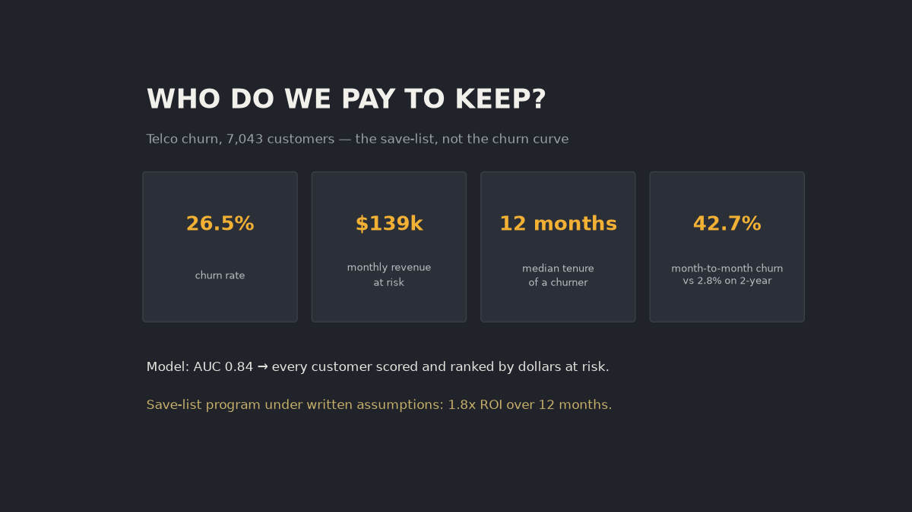
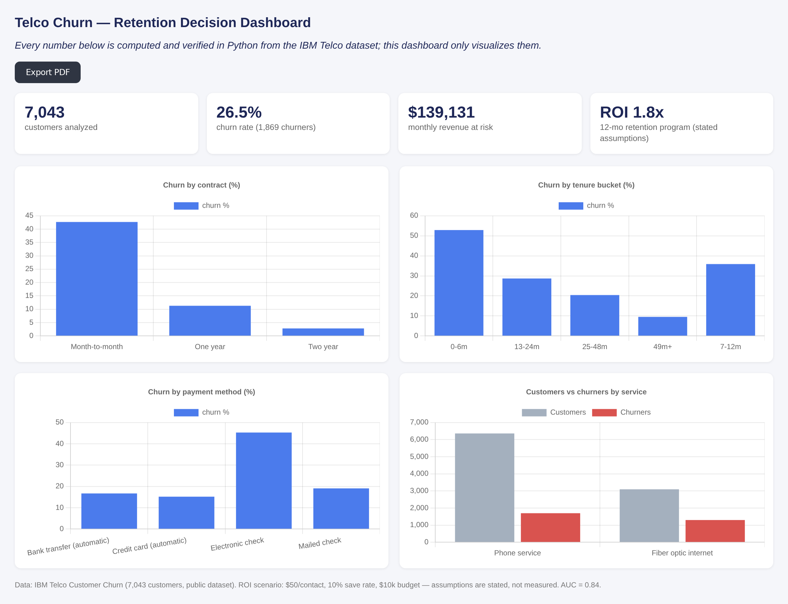
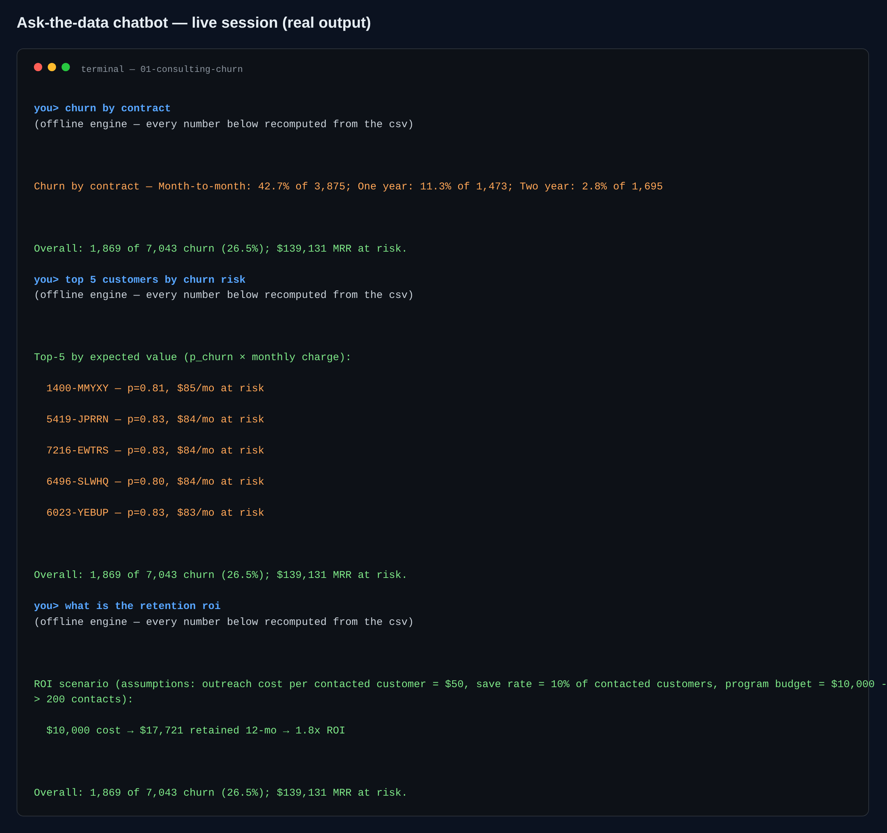

# Telco Churn — a retention decision for 7,043 customers



One question drove this whole folder: **who should the retention budget go to, and
does the program pay for itself?** IBM's public Telco dataset, 7,043 customers.



*The dashboard is a single HTML file — double-click it, export it to PDF.*



*The chatbot in a real session — same terminal you get from `python src/06_chat.py`.*

## What I did

1. Cleaned the raw file (11 blank TotalCharges belong to month-0 customers — coerced,
   logged).
2. Recomputed every headline fact straight from `data/processed/telco_clean.csv`.
3. Fit an interpretable logistic regression (one-hot, stratified 80/20, ROC AUC **0.84**
   held out) and scored every customer.
4. Ranked by expected value `p_churn × monthly charge` → `outputs/risk_scores.csv`.
5. Priced the save program against written-down costs.

## Numbers I stand behind

| fact | value |
|---|---|
| churn rate | **26.5%** (1,869 of 7,043) |
| MRR at risk | **~$139.1k** |
| contract effect | **42.7%** churn month-to-month vs ~2.8% two-year |
| tenure of churners | median **10 months** (stayers: 38) |
| model | AUC **0.84** |

## The program math (assumptions, labeled as such)

Outreach $50/customer, 10% save rate, $10,000 budget → 200 contacts → ~$1,477 MRR
retained → **$17.7k over 12 months ≈ 1.77× ROI**. Every one of those four numbers is
mine to change; the script is yours: rerun `02_model_roi.py` after editing them.

## Run it

```bash
python3 -m venv .venv
.venv/bin/pip install -r requirements.txt
.venv/bin/python src/00_download_data.py   # fetches the public CSV
.venv/bin/python src/01_prepare_analysis.py
.venv/bin/python src/02_model_roi.py       # the priced program lives here
.venv/bin/python src/03_ai_insights.py     # add a key in .env for LLM narration
.venv/bin/python src/04_dashboard.py       # writes dashboard/index.html
.venv/bin/python src/05_banner.py          # regenerates the banner above
```

## Ask the data instead

```bash
.venv/bin/python src/06_chat.py                      # REPL
.venv/bin/python src/06_chat.py "churn by contract"  # one-shot
```

It answers contract/payment/service churn, tenure medians, the ranked save-list and
the ROI scenario by re-reading the CSV at question time. Hand models a key
(`GROQ_API_KEY` in `.env`) and it narrates those verified facts; keyless it falls back
to the deterministic engine and the numbers don't move.

## Where it falls short

- One US telecom snapshot (2018). Directional, not causal; no seasonality.
- The $50/$10%/200-contact economics are assumptions, not measurements.
- Calibration wasn't tuned — for ranking, AUC + deciles do the work.

## Folder map

`src/` 00 download · 01 prep+segments · 02 model+ROI · 03 AI brief · 04 dashboard ·
05 banner · 06 chatbot — `data/` raw+clean — `outputs/` kpis, eval, risk_scores,
segments, charts — `dashboard/index.html` — `sql/analysis.sql` — `assets/` this
README's images — `requirements.txt`, `.env.example`.
